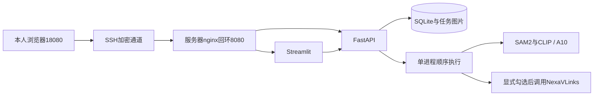

# 三阶段：云端部署与交付入口

更新：2026-10-23。本人感悟与9分30秒运行视频已完成，视频画面/完整性检查通过，声音清楚由本人确认。录制后六条任务已完成重建保留、备份及恢复核对，详见[视频与最终交付检查](视频与最终交付检查.md)。

此前技术验收：2026-10-22。阿里云香港 Ubuntu 服务器的 A10 GPU、Docker、网页/API/nginx 已真实联通。当前应用提交 `937529b79755e592d9516b99d23c62b35e73e871`；后续文档提交不改变该镜像中的应用代码。默认仍为 SAM2.1 tiny＋CLIP ViT-B/32，没有重训或替换二阶段模型。

**云资源收尾：2026-10-23已按本人授权释放香港 `gv-stage3-gpu` 实例及1块系统盘，阿里云控制台确认成功。六条历史的私有备份已取回并验证恢复；源码、感悟和视频保存在本地。原 `http://127.0.0.1:18080/` 云端通道不再可用，评审使用运行视频、源码及证据。** 8080是原本机CPU容器的地址，使用前需启动本机Docker服务。

## 已验证

| 检查 | 实际结果与证据 |
|---|---|
| 本机 Linux CPU | 两张开发图成功，约145.08秒（含初次加载）和120.10秒；`evidence/stage3/linux-container/acceptance.json` |
| 本机 Linux GPU 预检 | 两图成功，约21.04秒和12.67秒；仅本地模型 |
| 远端服务器 | Ubuntu24.04.4、A10 24GB、Docker29.8.0、Compose5.5.1、驱动580.126.09、容器工具1.17.8；真实CUDA运算通过 |
| 远端双方案 | 两张开发图本地推理8.895秒、8.702秒；外部请求14.412秒、22.126秒；同图哈希、导出和页面核对通过 |
| 外部实际费用 | NexaVLinks两次各尝试一次，合计0.0617103 NEX，来自服务商日志；不是阿里云券抵扣项 |
| 浏览器 | 云端创建免费本地任务成功，双侧历史展示、JSON下载一致 |
| 运维 | 远端容器重建、历史/图片/结果保留、隔离副本恢复通过；备份已下载D盘并核对哈希 |
| 版本回滚 | 本机独立8081项目新→旧→新已实测；`linux-container/rollback-20261022-140037-330.json` |
| 调用方式更新 | 云端改为manual；默认不勾选，仅显式创建时调用，不限测试次数；原两次授权记录保留。新版验证见`remote-linux/manual-mode/` |
| 服务测试 | 11项通过，使用模型替身；覆盖收费、防重、重启、历史、删除和数据库边界，不作为准确率证据 |

原双方案实测使用提交`0051dd2d290ef33c113653fd08d7069ffaf6716c`；新版复用同一依赖、权重与推理代码，只改调用授权和页面提示。所有远端证据集中在`evidence/stage3/remote-linux/`。两张开发图用于联通验证，不是独立准确率评估，仍存在错分、漏检及重复区域。

## 架构与访问

API只有一个worker；共享Bearer凭据不是多用户登录。重启将未完成任务标为中断，不自动重发收费请求。数据库结构版本为1，不兼容结构拒绝启动；没有通用跨版本迁移工具或高可用队列。

## 交付与剩余事项

技术说明、代码和证据已整理；[本人感悟](三阶段个人感悟.md)已修改完成，实际运行视频已收到并检查。本人已确认无需在线评审，服务器及关联系统盘已释放；剩余为最终发布确认与本人提交。当前工作在`stage3`分支，二阶段标签`stage2-submitted`保持原基线。最终合并main和发布标签须本人确认。

- [部署与运维](部署与运维.md)：配置、启动、备份和更新。
- [接口与任务说明](接口与任务说明.md)：请求、状态和收费方式。
- [项目说明与代码导览](项目说明与代码导览.md)：技术介绍及本人感悟位置。
- [验收与演示](验收与演示.md)：逐条验收、录屏和最少本人待办。
- [服务器建议](服务器建议.md)：选型依据、计费与学生券。

服务器仍按量计费，录完并取回备份后由本人决定何时释放；关闭网页不停止计费。
