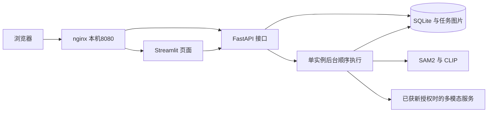

# 三阶段开发现状

更新：2026-10-22。三阶段复用原 SAM2.1 tiny＋CLIP ViT-B/32 与可配置多模态接口，不重训、不改写二阶段实验结果。二阶段基线为 `7a115ce1ee077552a4081dab42ccad1511e29093`，标签 `stage2-submitted`；三阶段在独立 `stage3` 工作树中开发。

## 已实现

- `stage3_app.py`：通过 HTTP 上传图片、创建任务、查询结果、查看历史、下载和删除。
- `garbage_vision/service.py`：FastAPI 接口、SQLAlchemy/SQLite 持久化、单线程后台模型执行、同图标识与重复提交防护。
- 两侧结果各自保存；一侧失败时仍可查看另一侧。页面刷新和历史查看只读取记录。
- 重启将未完成任务标记为中断，不自动重新发送请求。已开始但未确认的外部调用标记为 unknown。
- 共享 Bearer 访问凭据、收费授权编号与次数上限；本阶段默认上限为 0，未新增收费请求。
- Dockerfile、Compose 与 nginx 配置；统一网页端口默认仅绑定本机 `127.0.0.1:8080`。

## 实测范围

| 项目 | 当前证据与结论 |
|---|---|
| Windows 独立 Python、CUDA | 导入、依赖检查与真实矩阵运算通过 |
| Docker 基础 Linux 容器 | hello-world、D 盘挂载及 CUDA 容器内 nvidia-smi 通过；此项不等于模型容器推理通过 |
| Windows 真实 HTTP 模型链路 | `evidence/stage3/windows-http/summary.json`：两张开发图成功，API 均 skipped；核对同图哈希、重复提交、JSON 与标注图 |
| 服务边界测试 | `tests/test_stage3_service.py` 九项通过；含旧数据库兼容、拒绝不兼容结构、提示词缺失不预留费用。使用模型替身，不作为识别质量证据 |
| 浏览器 | Windows与Linux容器网页均已实际创建成功任务；历史/刷新/JSON下载通过，下载字节与HTTP导出一致；本轮确认下载后仍选中原任务。删除边界由服务测试验证 |
| Linux 应用容器 | 镜像构建与pip check通过，API/Web/nginx运行；两张真实CPU任务成功，分别约145.076秒（含加载）与120.100秒，哈希/像素/导出/防重通过。见 `evidence/stage3/linux-container/acceptance.json` |
| 容器重建与备份恢复 | 2026-10-22 维护脚本完整通过。两项历史的完整结果与图片哈希不变；备份副本在独立 Linux 容器中恢复通过，新增推理请求为 0。见 `persistence.json`、`restore-result.json` |
| 版本回滚 | 独立8081测试项目使用备份副本完成新→旧→新；api/web实际镜像ID与目标一致，各阶段历史、结果与图片保持一致。见 `rollback-20261022-140037-330.json` |
| 远端 Linux 服务器 | 尚无服务器访问或采购授权，未部署 |
| 本阶段多模态真实调用 | 尚未执行；旧二阶段调用不冒充本阶段新服务验证 |

Windows 两张图的 HTTP 全流程耗时约 51.172 秒（含首次加载）与 13.375 秒；Linux CPU任务耗时另见上表，统计口径略有区别。这是开发图链路验证，不是测试集准确率；仍有错分、漏检和重复区域等原模型局限。容器CPU实测不能直接当作云服务器性能。

原部署脚本在启动服务后的一条 `python -c` 探针因PowerShell引号截断失败，原记录保留在 `deploy-summary.json`。探针已修复；实际模型验证随后由助手通过HTTP完成，当前以 `acceptance.json` 和逐任务结果为本机应用验收依据，未冒充脚本已完整重跑成功。

## 结构

单进程后台执行适合本项目的小规模演示，不是 Redis/Celery 持久队列。API 只能使用一个 worker；SQLite 和文件锁共同约束同一数据目录的一份服务。数据库首次启动创建表，使用 user_version=1；只接纳列名一致的旧版未标版本数据，其他版本或列集合不符会拒绝启动。尚无通用跨版本迁移工具。

## 后续交付

下一步是远端 Linux 服务器部署与新授权双侧调用，以及最终材料和演示核对。服务器费用、外部模型新预算、本人感悟和录制需用户处理。本机 Linux 容器通过不等于远端服务器交付完成。

参见[部署与运维](部署与运维.md)、[接口与任务说明](接口与任务说明.md)、[服务器建议](服务器建议.md)、[项目说明与代码导览](项目说明与代码导览.md)、[验收与演示](验收与演示.md)。
