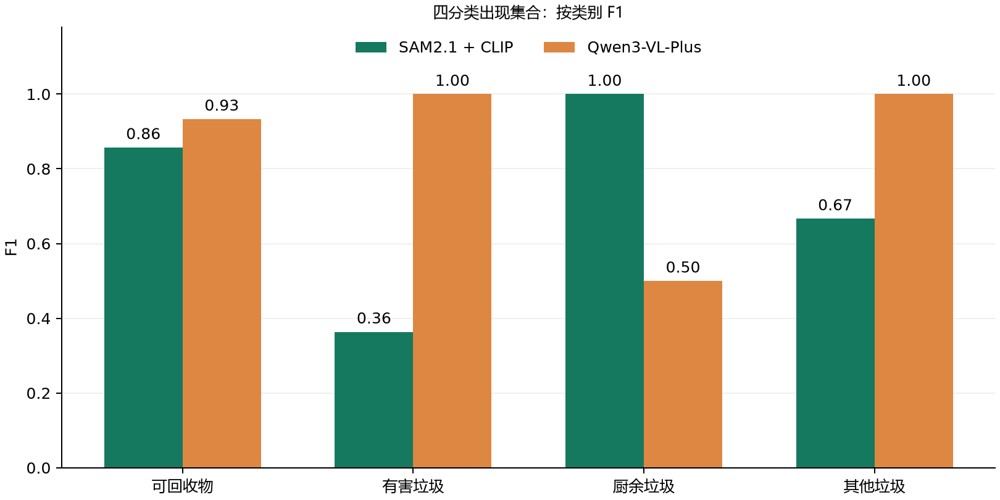

# 同图双方案独立测试报告

代码提交：`3442a3f2e1e6a4d0688f9ad635fc8535de51ecc7`。共 21 张固定图片。来源和预先复核标签见 freeze.json。

**参考标签来自作者元数据和 Codex 预先视觉复核，非独立真人标注。以下是小样本的探索性比较。**

## 共同任务与计分

主指标为每图四分类出现集合的 precision/recall/F1，再等权平均。未知不当作其他垃圾，空预测和失败不删除。没有真实框标注，不计算 mAP；不比较模型自述信心。

| 方案 | 平均 Precision | 平均 Recall | 平均 F1 | 集合完全一致率 | 失败率 | 空类别集合比例 | 含未知图片比例 |
|---|---:|---:|---:|---:|---:|---:|---:|
| SAM2.1 + CLIP | 0.5714 | 0.6667 | 0.6032 | 0.4762 | 0.0000 | 0.2857 | 0.6190 |
| Qwen3-VL-Plus | 0.8571 | 0.8571 | 0.8571 | 0.8571 | 0.1429 | 0.1429 | 0.0000 |

| 类别 | 真值出现图片数 | 本地 F1 | API F1 |
|---|---:|---:|---:|
| 可回收物 | 8 | 0.8571 | 0.9333 |
| 有害垃圾 | 4 | 0.3636 | 1.0000 |
| 厨余垃圾 | 3 | 1.0000 | 0.5000 |
| 其他垃圾 | 6 | 0.6667 | 1.0000 |

逐类别指标在所有图上聚合 TP/FP/FN，和先逐图平均的主指标不是同一种平均方式。

## 背景、耗时与费用

| 背景组 | 图片数 | 本地逐图平均 F1 | API 逐图平均 F1 |
|---|---:|---:|---:|
| 复杂 | 6 | 0.5000 | 0.8333 |
| 简单 | 15 | 0.6444 | 0.8667 |

| 方案 | 平均推理/请求秒 | 中位数秒 | 模型加载秒（单列） |
|---|---:|---:|---:|
| 本地 | 14.749 | 14.676 | 4.341 |
| API | 4.354 | 2.452 | 0.000 |

API 耗时包含网络，本地运行于记录中的 GPU；不同硬件/网络和并行负载会改变速度，不能据此给出普遍速度结论。

本批有返回用量的请求按公开价估算合计 **0.055116 元**；用量未知记录 0 条。免费额度与实际账单未核实。开发调用和网页验收费用不混入本批。

## 全部逐图对照

| 图片 | 参考类别 | 本地类别 | API 类别 | 本地 F1 | API F1 | 本地/API 状态 |
|---|---|---|---|---:|---:|---|
| commons-16844093 | 可回收物 | 有害垃圾、可回收物 | 可回收物 | 0.667 | 1.000 | success/success |
| commons-155061492 | 可回收物 | 有害垃圾、可回收物 | 可回收物 | 0.667 | 1.000 | success/success |
| commons-194221567 | 可回收物 | 空/未知 | 可回收物 | 0.000 | 1.000 | success/success |
| commons-150481714 | 可回收物 | 可回收物 | 可回收物 | 1.000 | 1.000 | success/success |
| commons-183494508 | 可回收物 | 可回收物 | 可回收物 | 1.000 | 1.000 | success/success |
| commons-192295022 | 可回收物 | 有害垃圾、可回收物 | 可回收物 | 0.667 | 1.000 | success/success |
| commons-192295023 | 可回收物 | 空/未知 | 可回收物 | 0.000 | 1.000 | success/success |
| commons-133246916 | 可回收物 | 有害垃圾、可回收物 | 空/未知 | 0.667 | 0.000 | success/error |
| commons-1742613 | 厨余垃圾 | 厨余垃圾 | 厨余垃圾 | 1.000 | 1.000 | success/success |
| commons-26750498 | 厨余垃圾 | 厨余垃圾 | 空/未知 | 1.000 | 0.000 | success/error |
| commons-18975566 | 厨余垃圾 | 厨余垃圾 | 空/未知 | 1.000 | 0.000 | success/error |
| commons-139914360 | 其他垃圾 | 有害垃圾 | 其他垃圾 | 0.000 | 1.000 | success/success |
| commons-181627306 | 其他垃圾 | 其他垃圾 | 其他垃圾 | 1.000 | 1.000 | success/success |
| commons-55127430 | 其他垃圾 | 空/未知 | 其他垃圾 | 0.000 | 1.000 | success/success |
| commons-56389070 | 其他垃圾 | 其他垃圾 | 其他垃圾 | 1.000 | 1.000 | success/success |
| commons-24681139 | 其他垃圾 | 其他垃圾 | 其他垃圾 | 1.000 | 1.000 | success/success |
| commons-129296105 | 其他垃圾 | 空/未知 | 其他垃圾 | 0.000 | 1.000 | success/success |
| commons-83033961 | 有害垃圾 | 有害垃圾 | 有害垃圾 | 1.000 | 1.000 | success/success |
| commons-39529354 | 有害垃圾 | 空/未知 | 有害垃圾 | 0.000 | 1.000 | success/success |
| commons-78060423 | 有害垃圾 | 有害垃圾 | 有害垃圾 | 1.000 | 1.000 | success/success |
| commons-25257168 | 有害垃圾 | 空/未知 | 有害垃圾 | 0.000 | 1.000 | success/success |

## 局限与证据追溯

- 类别出现集合不检查物品名称、数量或定位是否准确。即使集合一致，也可能包含物品幻觉或错误局部框。
- 测试样本小且类别不均，多物品主要为同类别；混合类别、遮挡和未知场景覆盖不足，不能外推城市实用准确率。
- SAM 的框可能表示局部区域；过滤未知部件只能减少部分重复，不保证物品计数。API 的文字解释同样可能误判材质与用途。
- 公共预训练数据重叠未知；测试独立性仅指未参与本项目选型/调参，参考标签尚缺独立人工复核。
- 模型别名可能更新；每次 API 原始记录保留返回 model、响应 ID、usage、时间和提示词哈希。
- 上级 freeze.json 保存代码、参数、权重和数据清单指纹；local/api 目录保留逐图结果与开始标记，包含失败。

本报告由 scripts/generate_report.py 从全部原始记录重新计分生成；没有隐藏失败图片或基于测试结果改参数。
